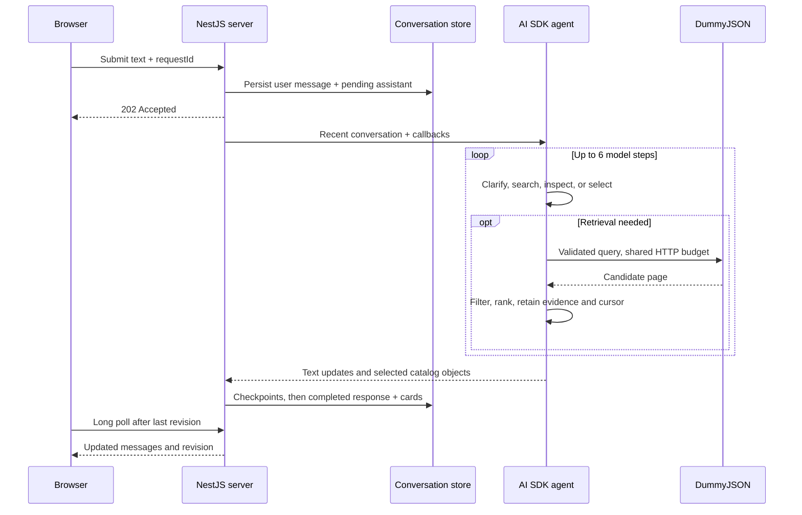

# Shopping agent architecture

The agent translates a conversation into catalog queries, inspects the returned evidence, selects products, and writes a short response. The model makes conversational and relevance decisions. TypeScript services enforce query constraints, request budgets, pagination, and product provenance.

This document describes the implemented application. Proposed extensions such as vector retrieval, automatic conversation compaction, and the Decisions API are not part of the production flow.

See [setup and usage](README.md), [application architecture](architecture.md), [submission decisions](submission.md), and [verification evidence](verification.md) for the surrounding system and validation results.

## Composition and boundaries

The agent lives in the independent [`@bazak/agent` package](packages/agent/src/index.ts). Its public `runAgent(messages, callbacks)` function does not depend on NestJS, HTTP, or the conversation database. The NestJS server supplies persisted messages and receives text, selected products, and search-state updates through callbacks. Evaluation code also subscribes to candidate, tool-call, and retrieval-outcome callbacks.

Within the package:

- [`agent.ts`](packages/agent/src/agent.ts) composes the Vercel AI SDK loop, context, tools, retrieval session, and selection service.
- [`tools/`](packages/agent/src/tools/index.ts) defines the model-facing contracts and delegates execution.
- [`application/`](packages/agent/src/application/search.ts) coordinates retrieval, continuation, evidence reuse, and selection.
- [`domain/catalog/`](packages/agent/src/domain/catalog/validation.ts) validates constraints and implements filtering and ranking.
- [`infrastructure/`](packages/agent/src/infrastructure/openai/model.ts) connects to OpenAI and DummyJSON.
- [`@bazak/shared`](packages/shared/src/index.ts) defines product, search-state, conversation, and HTTP schemas used across packages.

The provider is `createOpenAI(...).responses('gpt-6-luna')`. The server reads the key from its environment; the browser never receives it. Vercel AI SDK supplies typed tools, model/tool iteration, streaming, and provider integration. This local application uses OpenAI directly and does not require Vercel hosting or AI Gateway.

## A turn from input to cards

A clarification can finish without any catalog request. For a sufficiently specified request or an explicit request to browse, the model can retrieve immediately. Searches return candidates; they do not automatically create cards. The model calls `presentProducts` with selected IDs, then writes a brief response.

The [server generation runner](apps/server/src/conversations/application/generation-runner.ts) checkpoints streamed text at roughly 120 ms intervals when text arrives. It buffers cards until completion so they appear with the completed introduction. Generation continues after a browser disconnect because it is independent of the submission request. Long polling reads durable revisions after refresh; it does not restart the model call.

This is process-local execution, not a durable job queue. After a server restart, previously unfinished messages become errors instead of resuming an interrupted provider stream. Submission request IDs prevent duplicate turns, and only one generation can run per conversation.

## Tool contracts

All tool inputs have Zod schemas. Category values come from the [catalog allowlist](packages/agent/src/domain/catalog/categories.ts). A `categories` array contains one to three distinct supported categories.

Common optional constraints are `brand`, `minPrice`, `maxPrice`, `currency`, `sort`, and `attributes`, except where a tool makes one required. Price bounds are inclusive and nonnegative; minimum cannot exceed maximum. Brand is an exact, case-insensitive match after trimming. Currency defaults to `USD`; other currencies return an unsupported-currency error before HTTP. Sort is `relevance`, `price-asc`, or `price-desc` and applies within a fetched page.

| Tool | Required input | Other input and behavior |
| --- | --- | --- |
| `searchProducts` | `query`: 1–100 characters | Optional category and common constraints; `skip` defaults to 0, `limit` to 4, maximum 20. Literal keyword search, or local keyword filtering of a specified category. |
| `browseCategory` | `category` | Common constraints and the same pagination inputs/defaults. Fetches one category page. |
| `searchByAttributes` | `categories`, 1–6 `attributes` | Optional brand, price, currency, sort. Fetches the first 20 candidates from each chosen category, sharing the turn budget. |
| `searchByBrand` | `categories`, `brand`: 1–100 characters | Optional attributes, price, currency, sort. Uses the same multi-category retrieval path. |
| `searchByPrice` | `categories`, at least one price bound | Optional attributes, brand, currency, sort. Uses the same multi-category retrieval path. |
| `continueSearch` | Nonnegative integer `searchIndex` | Advances a saved or current-turn search without accepting replacement constraints. Excludes already shown product IDs. |
| `presentProducts` | `productIds`: 1–6 integers | Selects only IDs retrieved during this turn. One successful presentation per turn; duplicate IDs are collapsed. |

The tools share one retrieval session and one request budget. Choosing a different tool does not reset either. Multi-category tools return a result and continuation index per category, deduplicated products, and coverage metadata: requested, completed, and failed categories, whether more candidates remain, and `completeWithinQueriedCategories`. That final flag only describes the supplied categories and constraints.

### Generic attribute evidence

An [attribute filter](packages/shared/src/catalog/search-state.ts) has `name`, optional `terms` (default empty), `match` (`any` by default, or `all`), and optional `excludeTerms`. Names are descriptive labels, not verified catalog columns. There must be positive or negative terms; each term list allows up to 12 phrases, and each search allows up to six attributes.

The [matcher](packages/agent/src/domain/catalog/filters.ts) normalizes Unicode, case, punctuation, and whitespace, then matches whole phrases in title, description, and tags. Every attribute must pass. Within an attribute, positive terms use the chosen any/all rule; any excluded phrase rejects the product. Negative-only constraints need no positive terms. Unavoidable direct contradictions are rejected before retrieval.

The model supplies aliases, such as alternative descriptions of a product type. There is no footwear-specific dispatch or fixed style vocabulary. This keeps the tools reusable for fragrances, personal care, furniture, and other catalog categories, but alias quality remains a model decision. Phrase matching cannot establish subjective suitability or understand every synonym.

## Retrieval, pagination, and grounding

The [HTTP adapter](packages/agent/src/infrastructure/catalog/sources.ts) uses two endpoints:

- `/products/search?q=...&limit=...&skip=...` for keyword queries without a category.
- `/products/category/{category}?limit=...&skip=...` when a category is specified.

Price, brand, attributes, excluded IDs, and keyword checks are applied locally to the candidate page. There is no vector store or synchronized catalog copy. This avoids ingestion, embedding, freshness, and reconciliation infrastructure for a small external catalog, at the cost of network latency and limited recall under the request budget.

Each successful result includes the normalized query, products, upstream `total`, `hasMore`, optional `nextSkip`, actual attempts used, remaining attempts, and retry guidance. `total` counts upstream candidates before local filtering. A filtered page can be empty while later candidates remain. Continuation therefore advances by upstream candidates consumed, not matching products returned.

The [session](packages/agent/src/application/search-session.ts) assigns stable indices and preserves each search's constraints and latest cursor. It also tracks previously displayed IDs. A successful normalized page is [reused within the current turn](packages/agent/src/application/page-reuse.ts), including identical in-flight work; failed requests are not cached. Reuse reports the current budget and cannot rewind an advanced cursor. This is not a cross-turn hot-query cache.

[Ranking](packages/agent/src/domain/catalog/ranking.ts) computes a lexical term-match fraction and assigns it to both `score` and `confidence`. All query terms must match for a product to survive, so returned keyword matches currently have score 1; queries without keywords also receive 1. These fields are heuristics with little discriminatory power, not calibrated relevance probabilities. Price sorting is page-local, not a guarantee of the cheapest item in the catalog.

Product cards come from projected catalog objects: ID, title, description, price, USD currency, image, category, and optional rating. The [selection service](packages/agent/src/application/selection.ts) rejects IDs outside this turn's retrieved candidate pool. The model cannot supply replacement card prices or descriptions. However, selection relevance and claims in the response text still depend on model behavior; valid provenance alone does not prove a good recommendation.

## Conversation context and changing preferences

Full conversation history lives in the server's in-memory store with atomic disk snapshots. The [model context builder](packages/agent/src/application/context.ts) includes at most the latest 30 messages within 24,000 JavaScript string characters. It keeps whole messages, includes compact summaries of previously shown products and historical retrieval cursors, and removes leading assistant messages. Up to 12 recent search records are carried forward from the latest message containing searches.

This is bounded context selection, not summarization or automatic compaction. Older preferences can fall outside the window. The installed provider has compaction-related capabilities, but preserving and replaying that provider-specific state is not implemented here.

The [prompt](packages/agent/src/prompt.ts) treats the latest conversation agreement as authoritative. Exploring another price range does not itself authorize recommendations outside the old range; accepting alternatives updates the affected preference. Saved cursors are historical query state, not a structured source of current user preferences. The model must interpret those changes correctly and construct the next query accordingly. Once submitted, query constraints are enforced in code, but code cannot detect a constraint the model forgot to include.

The prompt also asks for one useful clarification when needed, respects explicit browsing requests, distinguishes search capability from verified availability, and limits conclusions to observed coverage. Size availability and currency conversion are unsupported. Catalog text is treated as data rather than instructions, though prompt-injection resistance is not a formal guarantee.

## Bounds and failure behavior

| Boundary | Implemented limit or behavior |
| --- | --- |
| Model loop | Up to 6 steps; `maxOutputTokens: 1600`; 90-second abort signal; SDK model retries disabled. A step limit is not a guarantee of a complete answer. |
| Catalog budget | 3 actual HTTP attempts across all tools, categories, pages, and retries per turn. Reservation happens synchronously before HTTP. |
| Catalog transport | 8-second timeout per request; at most 2 attempts per invocation for network errors, HTTP 429, or 5xx, with 150 ms backoff and subject to the shared budget. |
| Catalog rate limit | 30 HTTP attempts per rolling 60 seconds, shared within the server process. |
| Server admission | At most 3 active generations and 12 accepted turns per rolling 60 seconds in the process. |
| Cards | At most 6 selected IDs, once per agent turn. |
| Errors | Typed retrieval outcomes distinguish failures from empty successful results. Invalid responses and constraints do not silently become recommendations. |

Unsupported currency, contradictory attributes, and legacy style cursors receive explicit errors. Legacy records remain readable, but must be reconstructed with current generic attributes before retrieval. A failed later query does not invalidate successful evidence from an earlier query.

Provider or persistence failures mark the assistant response as failed and withhold buffered cards. If recording the failure itself cannot be persisted, the server exposes a transient failure state to avoid indefinite polling. There is no fabricated product fallback or alternate model.

## Why this design, and where it breaks

The AI SDK handles provider streaming and tool-loop mechanics while ordinary TypeScript retains the retrieval rules. Separate retrieval and presentation make informational questions possible without unwanted cards and make card provenance testable. The price is an additional selection step and continued dependence on the model to choose good evidence and explain it honestly.

Compared with LangChain, this implementation needs fewer orchestration abstractions for one provider and a bounded tool loop. A handwritten OpenAI loop would reduce SDK coupling but would require maintaining tool dispatch and stream handling directly. Neither comparison implies that AI SDK requires paid Vercel infrastructure.

The three-request ceiling makes usage predictable but can leave categories or pages unchecked, particularly for multi-intent requests or transient failures. Generic attributes improve over literal keywords but can miss synonyms or encode overly broad aliases. Exact-page reuse prevents identical repeated requests; it does not automatically recognize that a completed broad search already answers every narrower query. The prompt supplies that reasoning rule.

With more time, the highest-value improvements would be explicit versioned preference state, broader retrieval-quality evaluations, better relevance ranking, and deliberate context summarization. Multi-process deployment would also require shared rate limits, shared coordination, and a durable generation queue. These are separate needs from merely increasing the number of products.

## Evaluation and Decisions API status

[Deterministic tests](packages/agent/tests/retrieval.test.ts) cover filters, request budgets, retries, currency errors, selection provenance, cursor advancement, evidence reuse, and bounded context. Server integration tests exercise persistence and the HTTP lifecycle with an injected agent.

The [live evaluation runner](packages/agent/evals/run.ts) exercises the real agent and combines hard assertions with an LLM judge using the same `gpt-6-luna` model. Scenarios include ambiguity, multi-intent discovery, pagination, revised budgets, non-footwear discovery, currency handling, and availability claims. Observations preserve responses, candidates, selected products, calls, and retrieval outcomes before judging. The judge gets at most two attempts and fails closed if a typed verdict cannot be obtained. These evaluations are custom application code, not a managed evaluation feature supplied by AI SDK. Same-model judging can share the agent's blind spots and cannot replace human review.

Run `npm test` for deterministic tests, `npm run eval -- --list` to list live scenarios, and `npm run eval -- --filter natural-budget` for a scoped paid evaluation.

The Decisions API is not enabled in the shopping agent or judge. Production uses the Responses API tool loop described above. The separate `npm run benchmark:decisions` experiment is available for comparison; it is not a runtime dependency or fallback.
