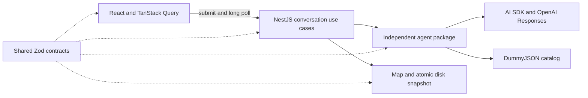

# Application architecture

The application separates chat lifecycle, product discovery and persistence into five local TypeScript workspaces. This keeps the model loop independently testable and lets the server own persistence even when the browser disconnects. See [agent-architecture.md](agent-architecture.md) for model and tool details and [verification.md](verification.md) for evidence.

## Code map

| Location                                       | Responsibility                                                                                       |
| ---------------------------------------------- | ---------------------------------------------------------------------------------------------------- |
| `apps/server/src/conversations/domain`         | Conversation transitions, errors and repository contract                                             |
| `apps/server/src/conversations/application`    | Submit a turn, read history, run generation and coordinate polling                                   |
| `apps/server/src/conversations/infrastructure` | Snapshot repository adapter, in-process admission and poll notifications                             |
| `apps/server/src/conversations/presentation`   | Nest controllers, request validation, cookies, origin guard and HTTP errors                          |
| `apps/web/src/conversations`                   | Query hooks, message merging, HTTP/browser adapters and chat/history components                      |
| `apps/web/src/catalog/presentation`            | Product cards and discovery landing page                                                             |
| `packages/agent/src/tools`                     | One tool definition per keyword, category, attributes, brand, price, continuation and presentation action |
| `packages/agent/src/application`               | Agent context, candidate search, cursor registry and selection                                       |
| `packages/agent/src/domain/catalog`            | Catalog types, filters, validation, ranking and verified category list                               |
| `packages/agent/src/infrastructure`            | OpenAI provider and DummyJSON transport, sources and request budget                                  |
| `packages/agent/evals`                         | Separate scenario files and common execution/judge/assertion support                                 |
| `packages/shared/src`                          | Runtime schemas, inferred API/domain types and genuinely shared rules                                |
| `packages/storage/src`                         | Conversation snapshot validation, atomic file operations and in-memory repository                    |

This is a practical DDD-inspired separation. Conversation state and catalog discovery are different responsibilities. Domain rules do not import UI or HTTP controllers. Application use cases depend on ports; adapters provide storage and transport. The frontend uses this separation without inventing entities or repository classes for simple React state.

## Follow one message

1. The composer submits through a TanStack mutation with a stable request UUID. The API adapter validates the shared request schema.
2. A Nest controller passes the validated input and browser owner ID to the submit-message use case.
3. Admission checks enforce one active generation per conversation and process-wide limits. The repository saves the user message and pending assistant before returning acceptance.
4. The generation runner calls `@bazak/agent` independently of the browser connection. The agent receives bounded conversation context and tool definitions.
5. The model selects a retrieval tool. That tool composes all known constraints; the shared search service selects an API source, reserves the request budget, validates candidates, filters and ranks them.
6. Retrieval only gathers evidence. `presentProducts` validates selected IDs against retrieved candidates. The generation runner buffers those cards until final text is complete.
7. TanStack Query long-polls revisions, cancels abandoned requests and merges newer snapshots with paginated messages. TanStack Virtual renders the visible rows. Closing a tab does not stop server generation.

## Why these choices

**A dedicated agent package.** The agent no longer knows about Nest, HTTP or React. It can run directly in evaluations and accept fake catalog transport in tests. The cost is an explicit package API and additional module navigation.

**NestJS.** The previous raw HTTP dispatcher combined routing, validation, persistence and generation control. Nest provides conventions for those boundaries and dependency injection. It adds dependencies and decorators; it is not automatically more correct. The preserved integration tests are the behavioral evidence.

**Attribute-specific tools.** Keyword, category, generic attribute, brand and price searches have different entry conditions. They share transport and filtering rather than copy it. Brand/price tools require one or more catalog categories. Every supplied constraint intersects with the others. Searching Nike and searching cheap products separately, then combining both lists, would violate user intent.

**Parallel retrieval.** Independent intents may execute concurrently through the AI SDK. HTTP attempts are reserved synchronously before any await. Every distinct HTTP page request and retry spends the same three-request allowance. Repeated successful pages and identical in-flight requests can reuse evidence within the current turn, without creating another HTTP attempt. Failures are not cached and nothing is reused across turns. Returned budget metadata reflects the current request count, and reuse never rewinds an advanced cursor. Parallelism does not expand the budget. A large request can therefore return partial coverage, which the assistant must acknowledge.

**TanStack Query and Virtual.** Query replaces manual request/cache/retry state and Virtual handles long histories. We still need domain-specific revision merging, idempotency and scroll anchoring; the libraries cannot infer those rules. Router and Form are deferred because this single-screen app does not currently need them.

**Useful shared contracts.** Zod schemas define accepted data once, with inferred TypeScript types. Server input, frontend responses and disk snapshots reuse them. This adds browser validation code but catches malformed responses at the boundary. Shared is not a place for random utilities, provider code or UI components.

**Verified category snapshot.** All 24 configured slugs matched the live category-list endpoint on 31 October 2026. The YAML describes that endpoint, not a fixed enum. A separate check detects future drift; no extra catalog request is added to each chat turn.

**Separate eval scenarios.** Baselines, pagination, the historical shoe regression and natural multi-turn conversations live in distinct scenario files. Common execution/judging records evidence before a verdict and fails when a judge remains unavailable after one retry. Splitting files improves reviewability, not model accuracy by itself.

## Retained limits

Only `gpt-6-luna` is used, through the OpenAI provider directly. Decisions remains an isolated benchmark. The application is local and single-process, with no account recovery or cross-device identity. Full history persists but model context is bounded. Attribute matching uses caller-supplied evidence terms, prices and ranking apply to inspected candidate pages, and three HTTP attempts cannot prove catalog-wide absence in every query.

The refactor preserves version-1 conversation snapshots. During the earlier modular refactor, all four then-existing local conversations validated against the shared schemas before startup. This was a point-in-time compatibility check. Existing history was not rewritten to change earlier model answers.

## Currency and generic discovery

Currency is an explicit tool argument and product field, with USD as the centralized catalog convention. Unsupported currency budgets fail before retrieval; values are never relabeled or converted using an invented rate. Generic category search replaced the footwear-specific dispatcher. Attribute names are labels; positive phrases, match modes and exclusions define actual evidence matching. Negative-only filters are supported. Historical `style` records load, but an old cursor must be reconstructed using current generic constraints before continuing.

The agent remains an AI SDK Responses tool loop. Decisions is not enabled in production. The conversation prompt prioritizes the latest accepted preferences, avoids mandatory budget interrogation and does not append stock disclaimers or questions by default.

## Final verification boundary

The final deterministic suite passes 100 tests across 23 files; type checking and the frontend production build pass. Latest scoped live natural-flow results are budget 4/4, discovery 2/2, currency 2/2 and stock 1/1 across separate runs. The final generic stop rule has not been rerun live. These results are evidence for the tested scenarios, not a claim that all 23 live cases or browser journeys passed on the final snapshot.

Attribute matching accepts positive evidence, negative-only exclusions, or both. It rejects unavoidable contradictory new requests before retrieval while keeping old stored records readable. Names such as material, scent and style label caller-supplied evidence filters; there is no product-specific production taxonomy. Optional retrieval-outcome callbacks expose successful, failed and reused pages to evaluations without persisting those diagnostics in conversations.
